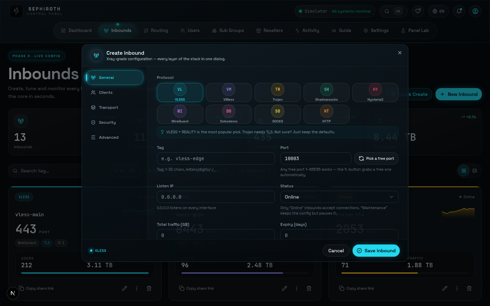
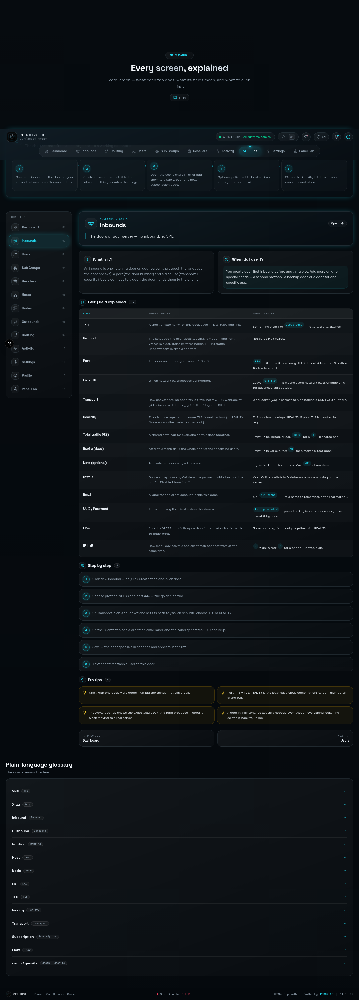
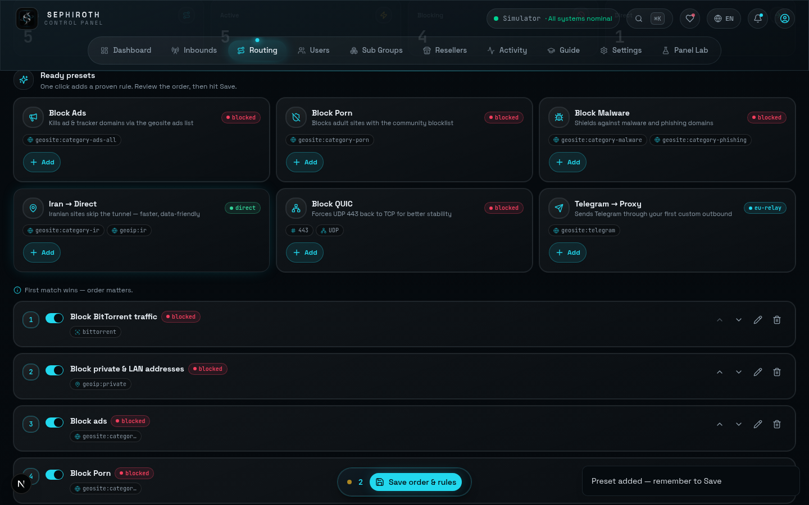
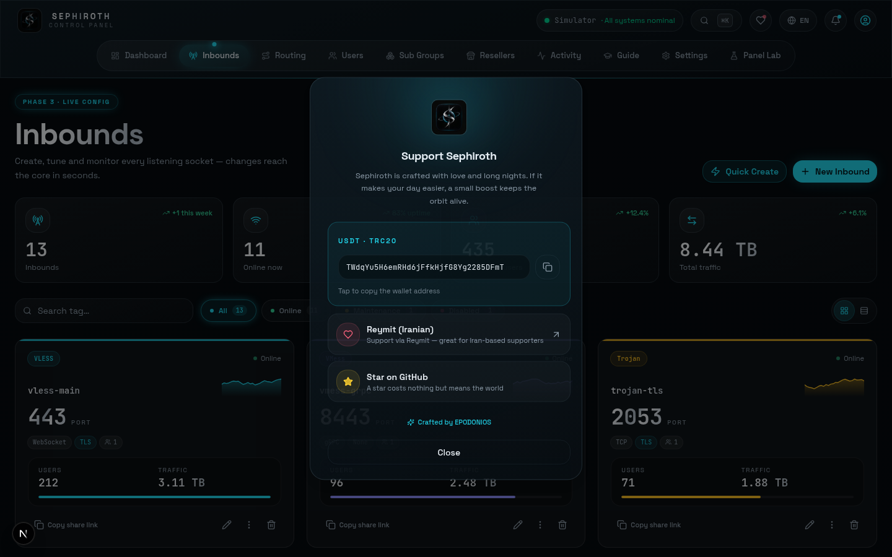
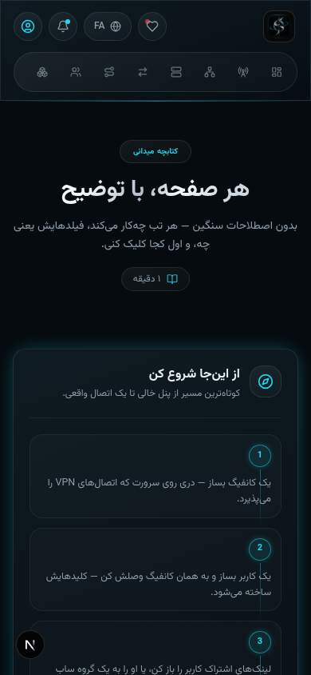

<div align="center">


<br>

<a href="https://github.com/Edsel-Rahimi/Sephiroth/stargazers"></a>
<a href="https://github.com/Edsel-Rahimi/Sephiroth/issues"></a>
<a href="https://react.dev"></a>
<a href="https://vite.dev"></a>
<a href="https://www.typescriptlang.org"></a>
<a href="https://expressjs.com"></a>

<br><br>


</div>

<div dir="rtl">


<div align="center">

</div>

**سیفیروت** یک پنل مدیریت **Xray** متن‌باز است که همه‌چیزِ یک سرور VPN را — از ساخت اینباند تا تحویل کانفیگ به کاربر — پشت یک شیشه‌ی تیره و آرام جمع می‌کند: اُبسیدینِ عمیق، نئونِ فیروزه‌ای و نقره‌ی پلاتینیوم. بدون شلوغی، بدون اصطلاح عجیب؛ فقط یک اتاق فرمان که کار می‌کند.

هر چیزی که در پنل می‌سازید — از لینک اشتراک تا کانفیگ WireGuard — به‌صورت خودکار با نشان **«Sephiroth»** برچسب‌گذاری می‌شود تا همیشه بدانید هر اتصال از کجا آمده.

<div align="center">

</div>

<div align="center">

</div>

| | |
|:---|:---|
| **📡 اینباند کامل** | ۹ پروتکل (VLESS · VMess · Trojan · Shadowsocks · Hysteria2 · WireGuard · Dokodemo · SOCKS · HTTP) با تب‌های عمومی/کلاینت‌ها/ترنسپورت/امنیت/پیشرفته در یک دیالوگ ثابت‌قد |
| **👥 کاربر و اشتراک** | کلیدهای خودکار، سهمیه‌ی ترافیک و انقضا، لینک‌ها/QR و صفحه‌ی اشتراک عمومی `/sub/[token]` با حالت قفل‌شده و رمز |
| **🌍 هاست و نود** | دامنه‌ی خودتان روی لینک‌ها (SNI/REALITY/مسیر) و نودهای چندسروری با Probe و تأخیر زنده |
| **🧭 روتینگ هوشمند** | قوانین ترتیبی با ماچرهای کامل geosite/geoip + **پریست‌های آماده** (بلاک تبلیغات، بلاک پورن، بلاک بدافزار، ایران→مستقیم، بلاک QUIC، تلگرام→پروکسی) |
| **📈 اتاق فرمان زنده** | داشبورد بلوکی با نمودار ترافیک، فید فعالیت زنده‌ی سوکت‌محور، تاریخچه‌ی جستجوپذیر و خروجی JSON |
| **🧑‍🏫 راهنمای میدانی** | ۱۳ فصل آموزشی؛ برای هر فیلد می‌گوید «یعنی چی» و «چه وارد کنی» — با زبانِ صفرِ شبکه |
| **📦 سابسکریپشن چندفرمتی** | یک لینک، سه خروجی: لیست خام (`raw`)، **Clash Meta / Mihomo (YAML)** و **Sing-Box v1.10+ (JSON)** + هدر `Subscription-Userinfo` برای گیج مصرف کلاینت‌ها |
| **🤖 ترمینال ربات تلگرام** | کنسول تعاملی تست ربات در تنظیمات — `/status`، `/users`، `/create_trial` و `/backup_now` با صدور آنی لینک اشتراک |
| **💳 درگاه‌های ریسلر** | زرین‌پال، تتر TRC20، شبکه‌ی TON و کارت‌به‌کارت + شارژ آنی سهمیه با محاسبه‌ی خودکار حجم و سقف کاربر |
| **🌐 تانل ایران→خارج** | تانل‌های معکوس xhttp-reverse و grpc-mux برای اختلالات شدید + تست زنده‌ی Latency |
| **🛡 WARP+ یک‌کلیکی** | پریست اوت‌باند WireGuard WARP و هدایت دامنه‌های تحریمی و هوش مصنوعی در روتینگ |
| **🎨 موتور ۶ تم کهکشانی** | Sephiroth Cosmic، Jenova Violet، Masamune Crimson، Matrix Terminal، OLED Void Gold، One-Winged Angel |
| **⌘K پرش سریع** | Command Palette برای پرش میان صفحات، اینباندها و تنظیمات |
| **🌐 شش زبان، راست‌چین از جنس اول** | فارسی، عربی، انگلیسی، چینی، ترکی و روسی با RTL منطقی و فونت‌های لوکال |
| **🎛 تنظیمات دو‌لایه** | تب **General** برای همه و تب **Expert** برای حرفه‌ای‌ها + ماژول‌های نوار بالا (Hosts/Nodes/Outbounds/Routing) با یک کلید روشن/خاموش می‌شوند |
| **🌙 اتمسفر سفیروت** | شیشه‌ی مات، درخشش سایان، ستاره‌های پس‌زمینه و حرکت‌های نرم — همه با احترام به `prefers-reduced-motion` |
| **⚙️ تک‌فرایندی، بدون دیتابیس خارجی** | UI + API + سوکت تله‌متری + نگهدارنده‌ی خودکار سهمیه‌ها روی **یک پورت**؛ دیتابیس JSON اتمی لوکال با seed خودکار |

<div align="center">

</div>

<div align="center">

</div>

| اتاق فرمان | دیالوگ اینباند |
|:---:|:---:|
|  |  |

| راهنمای میدانی | روتینگ + پریست‌ها |
|:---:|:---:|
|  |  |

| حمایت | موبایل · فارسی |
|:---:|:---:|
|  |  |

<div align="center">

</div>

<div align="center">

</div>

```bash
git clone https://github.com/Edsel-Rahimi/Sephiroth.git
cd Sephiroth && npm install     # یا: bun install

npm run dev                     # → http://localhost:3000
```

همین. دیتابیس JSON لوکال (`db/sephiroth-store.json`) در اولین اجرا خودش seed می‌شود — نیازی به هیچ سرویس خارجی نیست.

یا با داکر:

```bash
docker compose up -d --build
```

**ورود پیش‌فرض:** `admin` / `sephiroth` — و بعد از اولین ورود، از **Profile → Security** پسورد و کلید بازیابی را عوض کنید.

> 🔐 نکته‌ی امنیتی: حالت پیش‌نمایش داخل iframe (مثلاً sandbox ها) با متغیر محیطی `SEPH_PREVIEW_AUTH=1` فعال می‌شود؛ در استقرار واقعی این متغیر را **ست نکنید** تا پنل فقط با کوکیِ لاگین قابل دسترس باشد.

<div align="center">

</div>

> مسیر طلایی: اینباند بساز ← کلاینت بده ← لینک/اشتراک بگیر ← با هاست و روتینگ صیقل بده ← در Activity تماشا کن.


## 🗺 نقشه‌ی راه

- [x] طراحی Sephiroth Glass — اُبسیدین + سایان + پلاتینیوم
- [x] ۹ پروتکل اینباند با دیالوگ Xray-grade
- [x] کاربران، سهمیه‌ها، صفحه‌ی اشتراک عمومی و گروه‌های اشتراک
- [x] شبکه‌ی هسته‌ای: Hosts · Nodes · Outbounds · Routing
- [x] پریست‌های آماده‌ی روتینگ (بلاک پورن و …)
- [x] راهنمای میدانی ۱۳ فصلی با توضیح تک‌تک فیلدها
- [x] فعالیت زنده + تاریخچه + خروجی
- [x] تنظیمات General/Expert + سوییچ ماژول‌های نوار بالا
- [x] نشان «Sephiroth» روی هر کانفیگ خروجی
- [x] سابسکریپشن چندفرمتی — Clash Meta و Sing-Box + هدر userinfo
- [x] ترمینال ربات تلگرام + درگاه‌های پرداخت ریسلر + تانل‌های ایران→خارج
- [x] موتور ۶ تم کهکشانی + ⌘K پرش سریع
- [x] **v2.1 — پالایش انتشار عمومی**: دیالوگ اینباند از نو (پیش‌نمایش زنده‌ی لینک + مراحل شماره‌دار)، درایورهای واقعی Probe (TCP بجای تصادف)، نگهدارنده‌ی خودکار انقضا/بازه‌ی ترافیک، پشتیبان‌گیری کامل (Hosts/Nodes/Outbounds/Routing/Tunnels)، هدرهای برند (`X-Sephiroth` · `content-disposition` · `profile-web-page-url`)، کلید اختصاصی WireGuard برای هر کاربر، RTL کامل primitives و موبایل‌کارت کاربران
- [x] **v2.2 — هم‌ترازی با پنل‌های برتر**: ⓵ دکمه‌ی بروزرسانی خودِ پنل (چک نسخه از مخزن عمومی + آپدیت یک‌کلیکی + ری‌استارت — الگوی 3x-ui) ⓶ بکاپ خودکار روزانه‌ی سروری با نگهداری N فایل آخر و لیست دانلود/حذف ⓷ ورود دومرحله‌ای TOTP (QR، بدون وابستگی، کد اجباری برای غیرفعال‌سازی) ⓸ پروکسی MTProto تلگرام (سکرت dd/ساده + لینک‌های tg:// + دستورات mtg/erlang) ⓹ کمبو تک‌پورت (VLESS+TLS با fallback به تروجان داخلی و پنل — چند پروتکل روی یک پورت) ⓺ فرمت اشتراک Xray-JSON (`?format=xray`) + «کپی JSON سرور» در Forge ⓻ پاک‌سازی کامل دیتای دمو + تله‌متری واقعی
- [x] **v2.3 — ویژگی‌هایی که هیچ پنلی ندارد**: ⓵ **صحت‌سنج کانفیگ (Config Doctor)** — اسکن سلامت زنده‌ی کل کانفیگ با امتیاز ۱۰۰ و ۱۶ سناریو (پراکسی SOCKS/HTTP باز، TLS بدون گواهی، REALITY ناقص، فال‌بک خراب، کلید تکراری WireGuard، رول مرده، کاربر منقضی/سقف‌خورده…) ⓶ **پیش‌بینی اتمام ترافیک** — چیپ «≈N روز تا سقف» با نرخ سوخت روزانه برای هر کاربر ⓷ **پروکسی تلگرام SOCKS5** — بلوک اختصاصی در Forge با لینک `t.me/socks`، دیپ‌لینک `tg://` و QR قابل‌اسکن ⓸ تست اتصال خروجی‌ها (`POST /api/outbounds/:id/test`) ⓹ رفع کرش بوت سرور و CSS
- [x] **v2.3.1 — دیپلوی حرفه‌ای روی هاست‌های Pterodactyl (KataBump)**: ⓵ رفع باگ کوکی نشست (`Secure` مشروط به HTTPS واقعی — ورود روی هاست‌های بدون TLS مثل `IP:PORT` کتابامپ درست شد) ⓶ `SERVER_PORT` پتروداکتل + تشخیص خودکار `dist/` برای حالت production بدون Vite ⓷ باندل تک‌فایلی سرور با esbuild (بدون node_modules — `server.cjs` ~2MB) ⓸ پکیج دیپلوی خودکارِ self-extract (اپ‌لود ۲ فایل + دکمه‌ی استارت — `scripts/deploy/build-katabump.sh`) ⓹ راهنمای PDF فارسی کامل با تصاویر (`docs/sephiroth-katabump-deploy-guide-fa.pdf`)
- [ ] 🧠 درایور هسته‌ی واقعی Xray (فعلاً شبیه‌ساز زنده)
- [ ] 🤖 ربات فروش تلگرامی (فاز تحقیق — `docs/telegram-bot-research.md`)
- [ ] 📱 PWA

## ⚠️ سلب مسئولیت

این پروژه فقط برای مقاصد آموزشی و مدیریت قانونی سرورهای خودتان ساخته شده است. مسئولیت استفاده بر عهده‌ی خود کاربر است.


<div align="center">

</div>

سیفیروت با عشق و شب‌های بیداری ساخته شده. اگر کارتان را راه انداخته، یک انرژی کوچک مدار را روشن نگه می‌دارد 🛰️

**💳 تتر (TRC20):**
```
TWdqYu5H6emRHd6jFfkHjfG8Yg2285DFmT
```

<div align="center">

<a href="https://reymit.ir/edsel-rahimi"></a>
<a href="https://github.com/Edsel-Rahimi/Sephiroth/stargazers"></a>

</div>

</div>

<div dir="ltr" align="center">

**Sephiroth** is an open-source Xray control panel — a single-process full-stack app (React 19 + Vite + Express + Socket.IO, atomic local JSON store, zero external DB). 9 inbound protocols, multi-format subscriptions (raw list, Clash Meta YAML, Sing-Box JSON with `Subscription-Userinfo`), password-locked sub groups, hosts/nodes/outbounds/routing with one-click presets (block ads, block porn, Iran→direct…), Iran→foreign relay tunnels, a Telegram bot terminal, reseller payment gateways, a realtime telemetry cockpit, a 13-chapter field manual, 6 languages with first-class RTL and 6 cosmic themes. Every generated config is branded with the **Sephiroth** tag.

**License: MIT** — v2.1.0 ships the release polish pass: redesigned New-Inbound forge with live share-link preview, real TCP probes, automatic expiry/traffic-reset maintenance, full-scope backups, branded export headers (`X-Sephiroth`, `content-disposition`, `profile-web-page-url`), per-client WireGuard keypairs and full RTL primitive coverage.

</div>

<div align="center">


<a href="https://github.com/Edsel-Rahimi/Sephiroth/issues"></a>
<a href="https://github.com/Edsel-Rahimi"></a>

</div>
