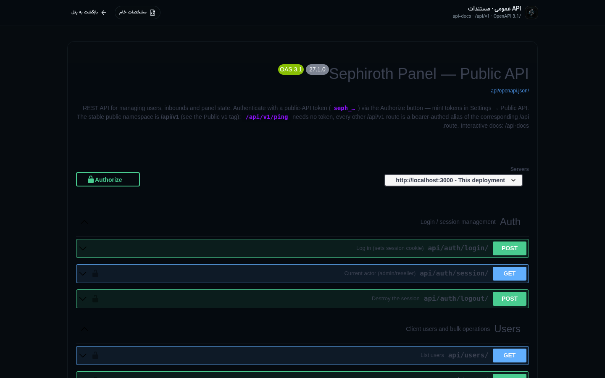
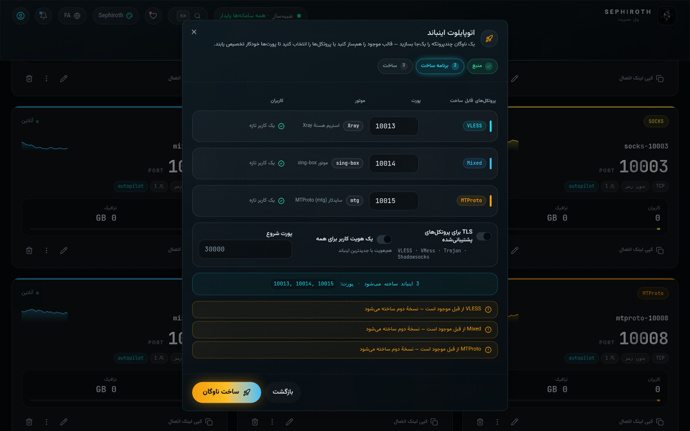

[English](README.md) | [فارسی](README.fa.md) | [العربية](README.ar.md) | [中文](README.zh.md) | [Türkçe](README.tr.md) | [Русский](README.ru.md)

<div align="center">



<br>

<a href="https://github.com/Edsel-Rahimi/Sephiroth/releases"></a>
<a href="https://github.com/Edsel-Rahimi/Sephiroth/stargazers"></a>
<a href="LICENSE"></a>
<a href="https://github.com/XTLS/Xray-core"></a>


<br><br>


<br>

<sub><b>forge · subscriptions · resellers · telegram bots · mini-app · payments · observability</b> — one process, one port, one JSON store</sub>

</div>


<div align="center">

</div>

**Sephiroth** is an open-source, next-generation control panel for [Xray-core](https://github.com/XTLS/Xray-core) servers. Everything a VPN operator touches — building inbounds, forging client configs, selling plans, watching traffic — lives behind one calm obsidian-glass cockpit that speaks **six languages** and treats right-to-left as a first-class citizen. A single Node.js process with an atomic local JSON store serves the UI, the API, the live telemetry socket and the maintenance cron on **one port** — no external database to babysit.

> **One panel. Nine protocols. Zero babysitting.**

| | |
|:---|:---|
| 🪟 **Glass cockpit** | deep-obsidian UI, 6 full themes, first-class RTL, ⌘K command palette |
| 🔨 **Per-client Forge** | one dialog builds any protocol; share link & sub preview update as you turn the knobs |
| 🩺 **Config Doctor** | 16 automated health checks with a 0–100 score |
| 📈 **Forecast chips** | "≈ N days to cap · rate/day" burn-rate under every traffic bar |
| 💼 **Reseller economy** | scoped resellers, sale templates, each reseller gets their **own Telegram bot** |
| ⚙️ **Real Xray driver** | true per-user stats, kill-resilient restart, hash-diff hot reload |


<div align="center">

</div>

### 🛡 Protocols & Transports

- **9 inbound protocols** — VLESS, VMess, Trojan, Shadowsocks (2022), Hysteria2, TUIC v5, WireGuard, **AmneziaWG**, SOCKS, HTTP, Dokodemo-door, MTProto proxy tool.
- **Security & transports** — TLS and **REALITY** over TCP, WebSocket, gRPC, HTTPUpgrade, XHTTP, mKCP; fallbacks & one-port combo preset.
- **REALITY scanner** — scan any target, grade it, pre-fill the forge, rotate SNI with a confirm step.

### 🎛 Management

- **Users, quotas & expiry** — per-client traffic limits, IP-limit + HWID device binding, bulk actions, one identity riding many inbounds.
- **Autopilot** — one-click inbound wizard incl. **single-port mode** (two protocols on one port via Xray fallbacks).
- **Sub groups & branded portal** — one public subscription page per group; output as raw list, Clash Meta, Sing-Box, Xray-JSON with `Subscription-Userinfo` metering.

### 💼 Business & Shop

- **Shop cart** — multi-item checkout with per-unit provisioning, **discount codes** (caps, single-use) and **referrals** (deep-link, first-paid wallet reward).
- **Payments** — ZarinPal, card-to-card, Tether TRC20, TON, **NowPayments crypto invoices** (HMAC-SHA512 IPN) and **Telegram Stars**.
- **Resellers** — scoped sub-operators with quotas, their own catalog, their **own Telegram bot**, and a **Telegram Mini App** storefront with `initData` HMAC validation.

### 📣 Reach & Automation

- **Telegram sales bot** — shop, wallet, renew, `/adduser`, quota edit, HWID reset, QR delivery, broadcast queue (≤20 msg/s, 429-backoff, cancel).
- **Anti-abuse** — force-join channel membership gate, ban/unban.
- **Discord bot** — slash commands + interactive button cards.
- **Webhooks** — 11 HMAC-signed events, per-event URL overrides, dead-letter queue with retry & viewer.

### 🔬 Operations & Observability

- **Live ops** — socket-driven cockpit, online-users roster with **bidirectional IP ↔ user drill-down** and CSV exports.
- **Prometheus** — `GET /api/metrics` with API-token auth, 10 metric families.
- **Update channels** — stable / beta with a cached GitHub Releases check.
- **RBAC** — owner / admin / viewer, last-owner protection, viewer read-only end-to-end.
- **Public API** — token-authenticated REST + in-panel OpenAPI/Swagger reference.
- **Config Doctor · scheduled backups · TOTP 2FA · self-update · hosts/nodes/outbounds/routing · free-port wand · traffic forecast**.


<div align="center">

</div>

<details open>
<summary><b>Tour & screenshots</b> — click to collapse</summary>

<p align="center">
  
</p>

<table>
  <tr>
    <td align="center" width="50%"><br><sub>Dashboard — live telemetry cockpit</sub></td>
    <td align="center" width="50%"><br><sub>Forge — one-click server IP auto-fill</sub></td>
  </tr>
  <tr>
    <td align="center" width="50%"><br><sub>Config Doctor — 16 checks, 0–100 score</sub></td>
    <td align="center" width="50%"><br><sub>Branded subscription portal</sub></td>
  </tr>
  <tr>
    <td align="center" width="50%"><br><sub>Public API — OpenAPI reference in-panel</sub></td>
    <td align="center" width="50%"><br><sub>Autopilot — single-port wizard</sub></td>
  </tr>
  <tr>
    <td align="center" width="50%"><br><sub>فارسی — dashboard, native RTL</sub></td>
    <td align="center" width="50%"><br><sub>Mobile — the same cockpit in your pocket</sub></td>
  </tr>
  <tr>
    <td align="center" width="50%"><br><sub>Forge auto-fill in motion</sub></td>
    <td align="center" width="50%"><br><sub>Mobile experience in motion</sub></td>
  </tr>
</table>

</details>


<div align="center">

</div>

### One-line install

```bash
bash <(curl -Ls https://raw.githubusercontent.com/Edsel-Rahimi/Sephiroth/main/install.sh)
```

The installer detects distro & architecture, installs dependencies **plus Node 22**, clones the repo, builds the app and creates a hardened **systemd** service. It prints the panel URL and a **randomly generated admin password**, and stores both in `/etc/sephiroth/install-result.env` (mode `0600`).

```bash
# pin a release
bash <(curl -Ls https://raw.githubusercontent.com/Edsel-Rahimi/Sephiroth/main/install.sh) v3.0.0
# unattended / cloud-init
SEPH_NONINTERACTIVE=1 bash <(curl -Ls https://raw.githubusercontent.com/Edsel-Rahimi/Sephiroth/main/install.sh)
```

### Docker

```bash
docker run -d --name sephiroth -p 3000:3000 -v sephiroth_data:/app/db \
  -e SEPHIROTH_ADMIN_USER=admin -e SEPHIROTH_ADMIN_PASS=change-me \
  --restart unless-stopped ghcr.io/edsel-rahimi/sephiroth:latest
```

```bash
# or compose — multi-stage build, named volume, healthcheck included
git clone https://github.com/Edsel-Rahimi/Sephiroth.git && cd Sephiroth
export SEPH_PORT=3000 SEPHIROTH_ADMIN_USER=admin SEPHIROTH_ADMIN_PASS='S3cure-Pass!'
docker compose up -d
```

> [!IMPORTANT]
> Change the admin password **right after the first login** and enable TOTP two-factor in Settings.

<details>
<summary><b><code>sephiroth</code> CLI — management menu</b></summary>

```text
sephiroth                  # open the interactive menu
  0) exit                  8)  change password
  1) start                 9)  change port
  2) stop                 10)  backup now
  3) restart              11)  restore backup
  4) force restart        12)  check update
  5) status               13)  update panel
  6) logs (follow)        14)  uninstall
  7) logs (last 100 lines)
```

Shortcuts: `sephiroth start | stop | restart | status | logs | update | backup`

</details>

<details>
<summary><b>Environment variables</b></summary>

| Variable | Purpose | Default |
|:---|:---|:---:|
| `SEPH_PORT` | host port (panel always listens on 3000 inside the container) | `3000` |
| `SEPHIROTH_ADMIN_USER` / `SEPHIROTH_ADMIN_PASS` | first-boot admin seed (only when the store is empty) | — |
| `SEPH_COOKIE_SECURE` | secure-cookie mode: `auto` / `on` / `off` | `auto` |

</details>

<details>
<summary><b>Operator endpoints</b></summary>

| Endpoint | Purpose |
|:---|:---|
| `GET /api/metrics` | Prometheus exposition (API-token auth, 10 families) |
| `GET /api/openapi` | machine-readable OpenAPI document (in-panel Swagger viewer) |
| Update channel | Settings → System → stable / beta (cached GitHub Releases check) |

</details>


<div align="center">

</div>

### Two interchangeable cores — switch any time in Settings → Core

| | **Simulator** (default) | **Real Xray core** |
|---|---|---|
| What runs | built-in telemetry simulator | a real **Xray-core** process |
| Config | panel state, previewed | generated from your inbounds, validated with `run -test` |
| Stats | simulated charts | true per-user / per-inbound counters (Xray stats API) |
| Resilience | n/a | auto-restart (3/10/30 s backoff) + hash-diff hot reload |
| Best for | trying the panel, staging | serving real traffic |

Switching to **Real Xray** auto-downloads the Xray-core binary from XTLS releases into `db/bin/xray`; pin a version, tune the stats interval (5–120 s), watch the live core log. If the real core ever fails, the panel falls back to the simulator automatically.


<div align="center">

</div>

| Document | What's inside |
|:---|:---|
| 📕 [Full catalog — Persian (PDF)](docs/sephiroth-catalog-fa.pdf) | every view, field and setting, illustrated |
| 🌍 [Catalogs](docs/sephiroth-catalog-en.pdf) · EN / AR / ZH / RU / TR | the same guide in five more languages |
| 🗕 [Release notes v3.0.0](docs/RELEASE-NOTES-v3.0.0.md) | what shipped in v2.9 → v3.0 |
| 📋 [Features checklist](docs/FEATURES-CHECKLIST.md) | the §20 shipping ledger — every claim, evidenced |
| 🧭 In-panel **Guide** view | 13 chapters, zero jargon |


## Roadmap

**Shipped**

- [x] v2.5.0 — Telegram sales bot · multi-node fleet · SS2022 / mKCP / Hysteria2 · sing-box second core · in-panel SSL/ACME · IP-limit + HWID
- [x] v2.7.0 — webhooks (11 events) · Discord bot · online users · REALITY scanner · users CSV round-trip
- [x] v2.8.0 — bot wallet / renew / adduser / QR · autopilot **single-port** mode · Discord slash + buttons · secrets purge & release prep
- [x] v2.9.0 — per-event webhooks + dead-letter queue · shop cart + discounts + referrals · broadcast queue + anti-abuse · Prometheus metrics · update channels
- [x] v3.0.0 — NowPayments crypto + Telegram Stars · RBAC (owner/admin/viewer) · per-reseller Telegram bots · **Telegram Mini App** storefront

**What's next**

- [ ] Xray-JSON subscription format parity
- [ ] ACME certificate auto-renewal daemon
- [ ] Per-inbound TLS certificates
- [ ] Multi-node scheduled orchestration


<div align="center">

</div>

<div align="center">

If Sephiroth saves you hours every week, a star is the cheapest thank-you:

<a href="https://github.com/Edsel-Rahimi/Sephiroth/stargazers"></a>

| Wallet | Address |
|:---|:---|
| **USDT · TRC20** | `TWdqYu5H6emRHd6jFfkHjfG8Yg2285DFmT` |
| ❤️ [Reymit](https://reymit.ir/epodonios) | monthly Iranian supporters |

</div>


<div align="center">


<sub>Built on <a href="https://github.com/XTLS/Xray-core">Xray-core</a> · licensed <a href="LICENSE">MIT</a> · <a href="CONTRIBUTING.md">contributions welcome</a></sub>

</div>
