[English](README.md) | [فارسی](README.fa.md) | [العربية](README.ar.md) | [中文](README.zh.md) | [Türkçe](README.tr.md) | [Русский](README.ru.md)

<p align="center">
  
</p>

<h1 align="center">Sephiroth</h1>

<p align="center">
  <strong>Панель управления Xray нового поколения</strong> — тёмный обсидиановый интерфейс со стекломорфизмом, 6 языков, драйвер реального ядра Xray.
</p>

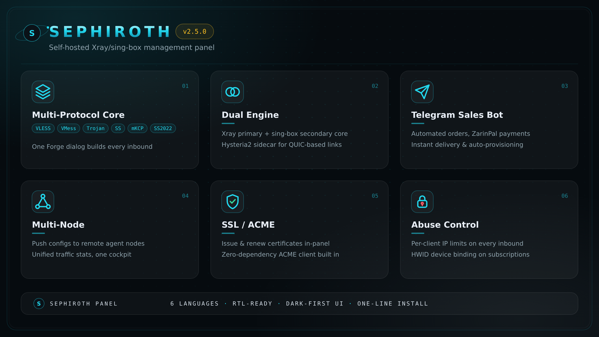

<p align="center">
  <a href="https://github.com/Edsel-Rahimi/Sephiroth/releases"></a>&nbsp;
  <a href="LICENSE"></a>&nbsp;
  <a href="https://nodejs.org"></a>&nbsp;
  &nbsp;
  &nbsp;
  <a href="https://github.com/Edsel-Rahimi/Sephiroth/stargazers"></a>
</p>

---

## Что такое Sephiroth?

**Sephiroth** — открытая панель управления нового поколения для серверов [Xray-core](https://github.com/XTLS/Xray-core). Всё, к чему прикасается оператор VPN — создание подключений, выдача конфигов клиентам, наблюдение за трафиком, запуск реального ядра Xray — собрано за спокойной обсидианово-стеклянной кабиной, которая говорит на шести языках и считает письмо справа налево полноправным гражданином. Внешнюю базу данных заводить не нужно: один процесс Node.js с атомарным локальным JSON-хранилищем раздаёт UI, API, сокет живой телеметрии и фоновое обслуживание на **одном порту**. Текущая версия: **v2.5.0**.

Чем он отличается:

- 🪟 **Стеклянный интерфейс с 6 темами** — глубокий обсидиан, неоновая бирюза, платиновое серебро; шесть полноценных тем (Sephiroth Cosmic, Jenova Violet, Masamune Crimson, Matrix Terminal, OLED Void Gold, One-Winged Angel) и настоящий RTL.
- 🔨 **Кузница (Forge) с живым предпросмотром для каждого клиента** — одно диалоговое окно собирает любой протокол; ссылка и предпросмотр подписки обновляются, пока вы крутите ручки.
- 🩺 **Оценка Доктора конфигов** — 16 автоматических проверок здоровья и балл от 0 до 100; аналогов в других панелях нет.
- 📈 **Прогноз исчерпания трафика** — под полосой трафика каждого пользователя чипы «≈ N дней до лимита · расход/день».
- 💼 **Реселлеры + шаблоны продаж + платёжные шлюзы** — комбинация, которой нет ни у одной другой open-source панели.
- ⚙️ **Драйвер реального ядра Xray** — опциональное боевое ядро с честной статистикой по каждому пользователю; встроенный симулятор остаётся дефолтом без лишней настройки.

## Возможности

### Протоколы и транспорты

- **9 протоколов подключений** — VLESS, VMess, Trojan, Shadowsocks, Hysteria2, WireGuard, SOCKS, HTTP и Dokodemo-door.
- **Безопасность и транспорты** — TLS и REALITY поверх TCP, WebSocket, gRPC, HTTPUpgrade и XHTTP.
- **Fallback'и и пресет «всё на одном порту»** — несколько протоколов (например, VLESS + Trojan + сама панель) на одном порту благодаря fallback'ам Xray.

### Управление пользователями

- **Пользователи, квоты и сроки** — лимит трафика и дата истечения на каждого клиента, включение/отключение и массовые операции; одна личность может ездить на нескольких подключениях.
- **Чипы прогноза** — предсказание скорости расхода («≈ N дней до лимита») под полосой трафика каждого пользователя; янтарь за 7 дней, багрянец за 3.
- **Группы подписок и брендированный портал** — одна публичная страница подписки на группу, с защитой паролем; выдача в форматах **сырой список, Clash Meta (Mihomo), Sing-Box и Xray-JSON** с заголовком `Subscription-Userinfo` и QR-кодами.

### Надёжность

- **Драйвер реального ядра Xray** (опционально; по умолчанию симулятор) — настоящий процесс Xray-core, собранный из ваших подключений, честная статистика по пользователям и по подключениям, автоперезапуск после kill и горячая перезагрузка по хеш-разнице.
- **Доктор конфигов** — 16 проверок с оценкой из 100: открытые SOCKS/HTTP-прокси, TLS без сертификата, недоделанный REALITY, сломанные fallback'и, дублированные ключи WireGuard, мёртвые правила маршрутизации, призрачные аккаунты и не только.
- **Расписание бэкапов** — ежедневные снимки сервера с хранением последних N файлов, скачивание или восстановление в один клик.
- **TOTP 2FA** — вход через RFC-6238-аутентификатор без единой зависимости; отключение требует действующий код.
- **Кнопка самообновления** — проверить → применить → перезапустить, прямо из панели.

### Бизнес

- **Реселлеры** — подчинённые операторы с квотами на число пользователей и трафик, которые видят только своих пользователей.
- **Шаблоны продаж** — пакеты в один клик (трафик, срок, лимит IP), которые реселлеры открывают мгновенно.
- **Платёжные шлюзы** — ZarinPal, Tether TRC20, TON и перевод с карты на карту, с тарифом за ГБ и автоматическими платёжными вебхуками.

### Telegram

- **Консоль бота** — `/status`, `/users`, `/create_trial`, `/backup_now` с мгновенной выдачей ссылок подписки.
- **Набор SOCKS5-прокси** — нативные для Telegram ссылки `t.me/socks` и сканируемые QR-коды.
- **Инструмент секретов MTProto** — секреты dd/простые, ссылки `tg://` и готовые команды демона.

### Эксплуатация

- **Автоопределение IP сервера + палочка свободного порта** — выпадающий список адреса прослушивания в один клик (публичный → приватный → все интерфейсы) и предложенный свободный порт в кузнице; `0.0.0.0` больше никогда не протечёт в клиентские ссылки.
- **Хосты · Узлы · Исходящие · Маршрутизация** — переопределение доменов для красивых ссылок, удалённые узлы с живыми пробами, цепочки исходящих и готовые пресеты маршрутизации (блок рекламы, Иран→напрямую, блок QUIC…).
- **Живая эксплуатация** — телеметрия на сокетах, живая лента активности плюс история с поиском и выгрузкой в JSON.
- **6 тем · 6 языков** — обсидианово-стеклянный тёмный интерфейс с первоклассным RTL (فارسی / العربية) и палитрой команд ⌘K.

## Скриншоты

<details open>
<summary><b>Скриншоты и GIF</b> — нажмите, чтобы свернуть</summary>

<p align="center">
  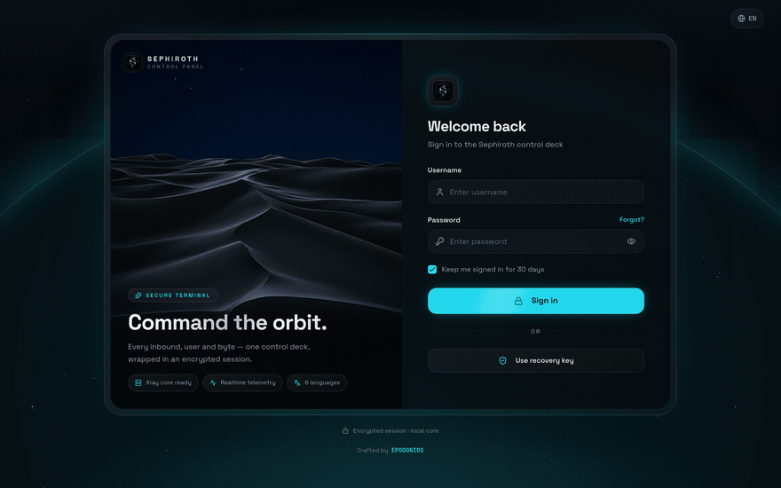
</p>

<table>
  <tr>
    <td align="center" width="50%">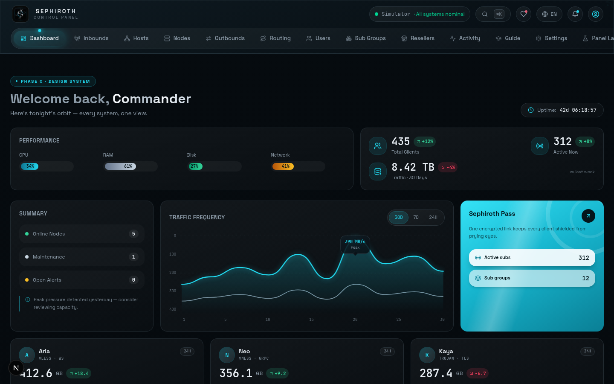<br><sub>Центр управления — живая телеметрия</sub></td>
    <td align="center" width="50%">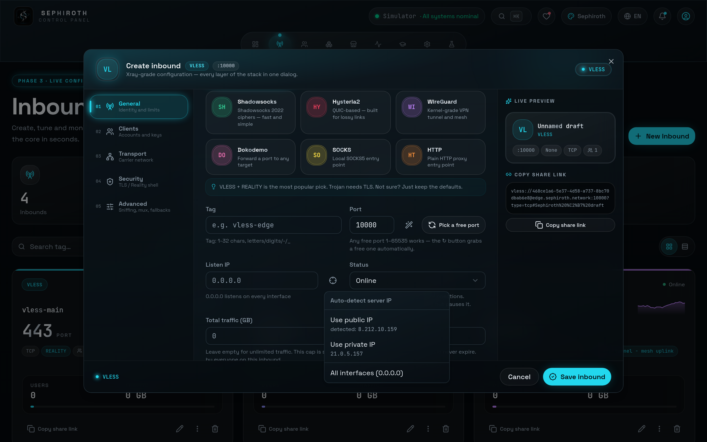<br><sub>Кузница — IP сервера в один клик</sub></td>
  </tr>
  <tr>
    <td align="center" width="50%">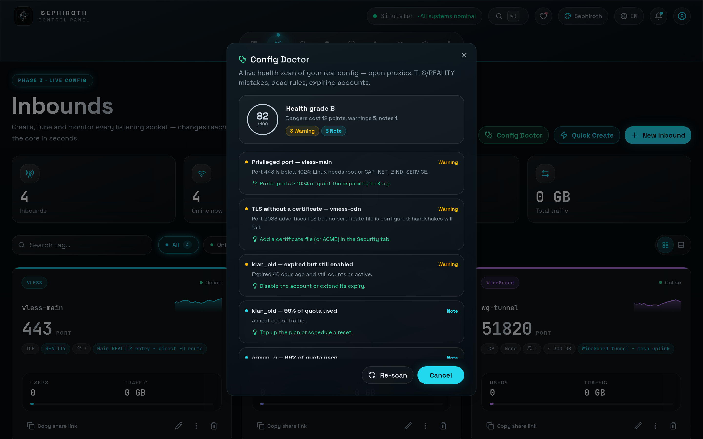<br><sub>Доктор конфигов — 16 проверок, оценка 0–100</sub></td>
    <td align="center" width="50%">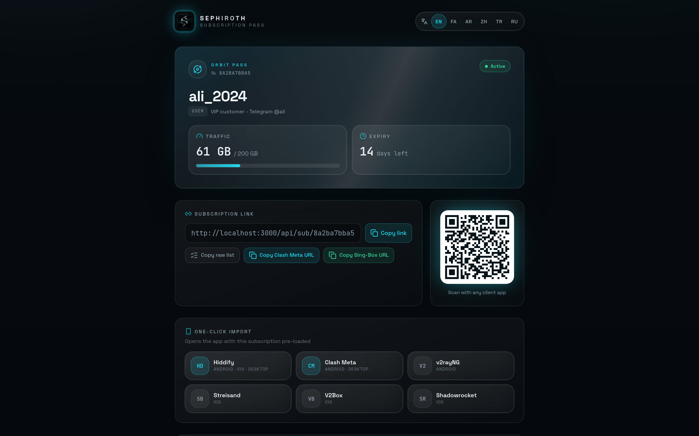<br><sub>Брендированный портал подписки</sub></td>
  </tr>
  <tr>
    <td align="center" width="50%">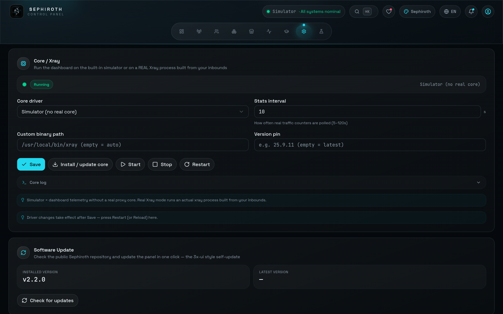<br><sub>Настройки → Ядро — реальный драйвер Xray</sub></td>
    <td align="center" width="50%">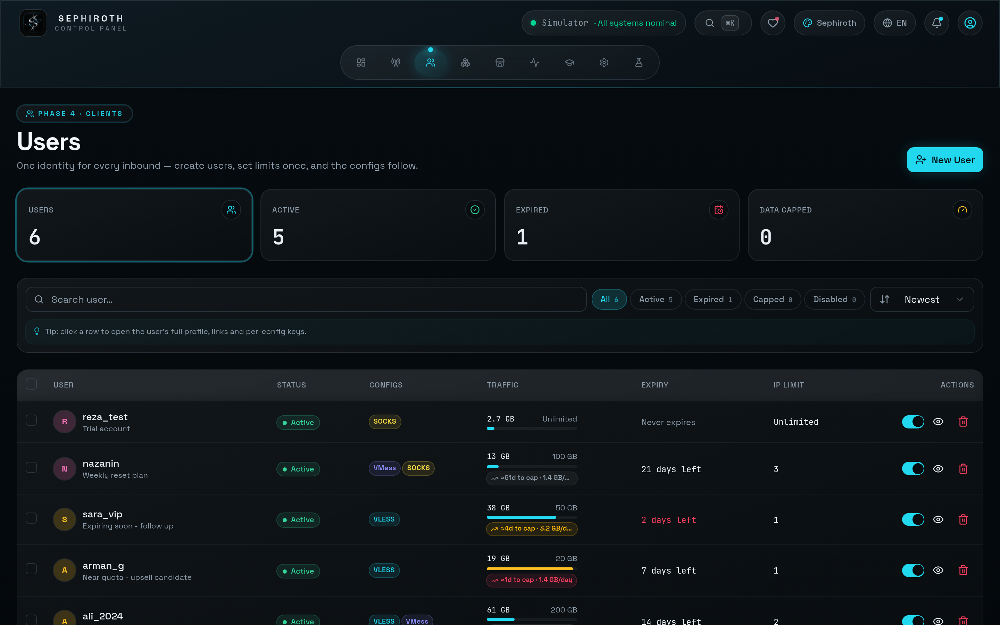<br><sub>Пользователи — квоты, сроки и чипы прогноза</sub></td>
  </tr>
  <tr>
    <td align="center" width="50%">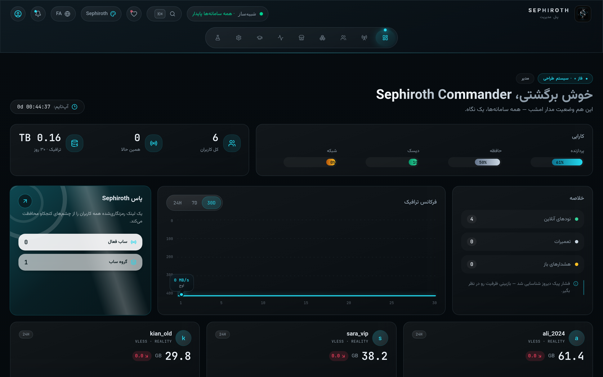<br><sub>فارسی — панель, нативный RTL</sub></td>
    <td align="center" width="50%">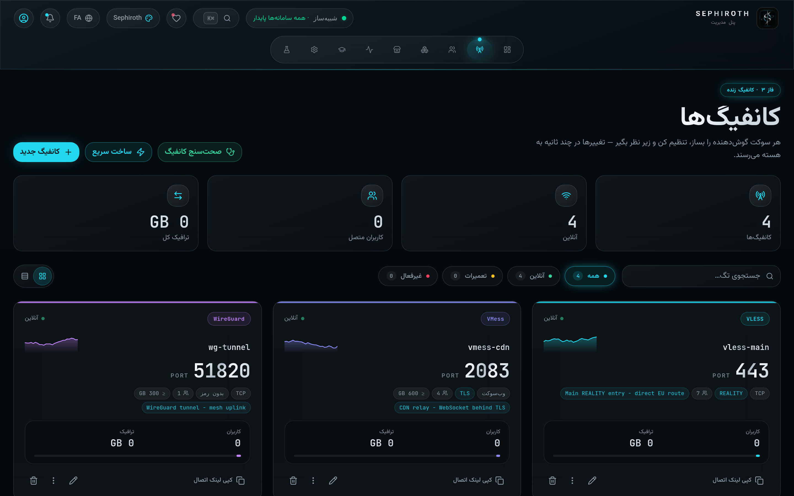<br><sub>فارسی — подключения</sub></td>
  </tr>
  <tr>
    <td align="center" width="50%">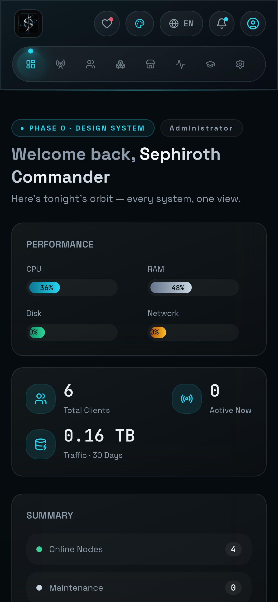<br><sub>Мобильный — панель</sub></td>
    <td align="center" width="50%">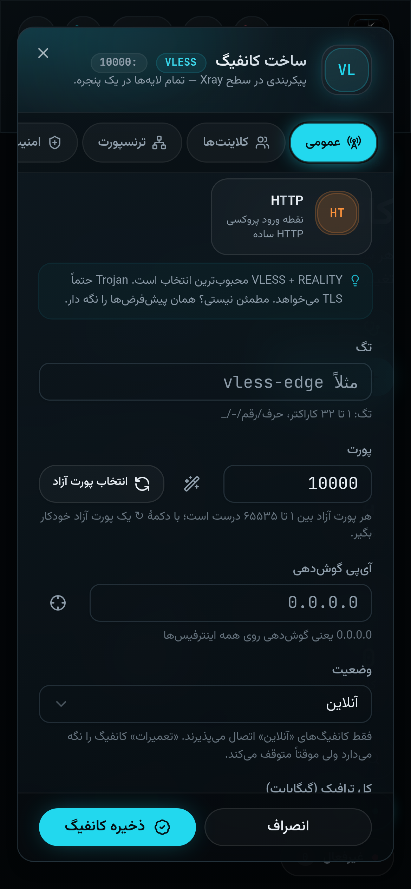<br><sub>Мобильный — кузница</sub></td>
  </tr>
  <tr>
    <td align="center" width="50%">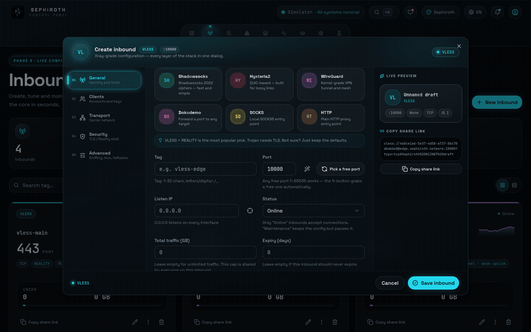<br><sub>Автоподстановка в кузнице в движении</sub></td>
    <td align="center" width="50%">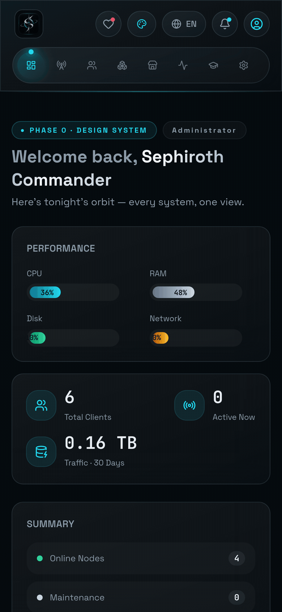<br><sub>Мобильный опыт в движении</sub></td>
  </tr>
</table>

</details>

## Быстрый старт

### Установка в один клик

```bash
bash <(curl -Ls https://raw.githubusercontent.com/Edsel-Rahimi/Sephiroth/main/install.sh)
```

Установщик определит дистрибутив и архитектуру, поставит системные зависимости **и Node 22**, склонирует репозиторий, соберёт приложение и создаст защищённый сервис **systemd** (с ограждением на случай отсутствия systemd). В конце он напечатает адрес панели и **случайно сгенерированный пароль администратора**, а оба значения сохранит в `/etc/sephiroth/install-result.env` (права `0600`).

Чтобы установить конкретный релиз, передайте тег аргументом (тег должен существовать в git-тегах этого репозитория — иначе установщик завершится с понятной подсказкой):

```bash
bash <(curl -Ls https://raw.githubusercontent.com/Edsel-Rahimi/Sephiroth/main/install.sh) v2.5.0
```

Неинтерактивная установка / cloud-init — ноль вопросов; пароль по-прежнему попадает в файл результата:

```bash
SEPH_NONINTERACTIVE=1 bash <(curl -Ls https://raw.githubusercontent.com/Edsel-Rahimi/Sephiroth/main/install.sh)
```

> [!IMPORTANT]
> Пароль администратора печатается **один раз** при установке и сохраняется в `/etc/sephiroth/install-result.env` (права `0600`). **Сразу после первого входа смените его** — и включите встроенную двухфакторную аутентификацию TOTP.

### Docker

```bash
docker run -d --name sephiroth -p 3000:3000 -v sephiroth_data:/app/db \
  -e SEPHIROTH_ADMIN_USER=admin -e SEPHIROTH_ADMIN_PASS=change-me \
  --restart unless-stopped ghcr.io/edsel-rahimi/sephiroth:latest
```

Или через Compose (многоступенчатая сборка, именованный том, встроенный healthcheck):

```bash
git clone https://github.com/Edsel-Rahimi/Sephiroth.git && cd Sephiroth
export SEPH_PORT=3000 SEPHIROTH_ADMIN_USER=admin SEPHIROTH_ADMIN_PASS='S3cure-Pass!'
docker compose up -d
```

- Порт хоста по умолчанию `${SEPH_PORT:-3000}` — панель всегда слушает 3000 внутри контейнера.
- JSON-хранилище и автобэкапы живут в томе `sephiroth_data`.
- Встроенный healthcheck опрашивает `/api/auth/session`; готовый образ публикуется в `ghcr.io/edsel-rahimi/sephiroth` при каждом пуше.

### Командная строка `sephiroth`

<details>
<summary><b>Меню управления</b> — команда <code>sephiroth</code> (пункты 0–14)</summary>

```text
sephiroth                  # open the interactive menu
  0) exit                  8)  change password
  1) start                 9)  change port
  2) stop                 10)  backup now
  3) restart              11)  restore backup
  4) force restart        12)  check update
  5) status               13)  update panel
  6) logs (follow)        14)  uninstall
  7) logs (last 100 lines)
```

Ярлыки: `sephiroth start | stop | restart | status | logs | update | backup`

</details>

## Драйвер ядра

В Sephiroth два взаимозаменяемых бэкенда ядра. Переключайтесь в любой момент: **Настройки → Ядро**:

| | **Симулятор** (по умолчанию) | **Реальное ядро Xray** |
|---|---|---|
| Что работает | встроенный симулятор телеметрии | настоящий процесс **Xray-core** |
| Конфиг | состояние панели, предпросмотр | генерируется из ваших подключений, проверяется через `run -test` |
| Статистика | симулированные графики | настоящие счётчики по пользователям и по подключениям (stats API Xray) |
| Живучесть | — | автоперезапуск после kill (задержка 3/10/30 с) + горячая перезагрузка по хеш-разнице |
| Для чего | попробовать панель, репетиция | реальный трафик |

При переключении на **реальное ядро Xray** панель автоматически скачает бинарник Xray-core из релизов XTLS/Xray-core (с цепочкой распаковки unzip → 7z → python3) в `db/bin/xray`. Можно закрепить конкретную версию ядра, задать интервал статистики (5–120 с) и смотреть живой лог ядра прямо в настройках. Если реальное ядро не стартует, панель автоматически возвращается к симулятору.

## Документация

- 📕 **[Полный каталог — фарси (PDF)](docs/sephiroth-catalog-fa.pdf)** — исчерпывающий визуальный справочник по всем экранам, полям и настройкам.
- 🗒 Changelog'и релизов (PDF на фарси): [v2.2](public/sephiroth-v2.2-changelog-fa.pdf) · [v2.3](public/sephiroth-v2.3-changelog-fa.pdf)
- 🧭 Встроенный экран **Гид** — 13 глав, которые объясняют каждое поле простым языком, без жаргона.

## Дорожная карта

**Готово**

- [x] Самообновление панели (проверить → применить → перезапустить)
- [x] Расписание бэкапов сервера с политикой хранения
- [x] Двухфакторный вход TOTP
- [x] Инструмент MTProto-прокси для Telegram
- [x] Доктор конфигов — 16 проверок + оценка
- [x] Чипы прогноза трафика
- [x] Драйвер реального ядра Xray
- [x] Комплект развёртывания — установщик в один клик · CLI `sephiroth` · Docker / GHCR

**Дальше**

- [ ] Телеграм-бот продаж (исследование готово — `docs/telegram-bot-research.md`)
- [ ] Механизм синхронизации между узлами
- [ ] Управление сертификатами ACME
- [ ] Принудительный лимит IP

## Участие в разработке

Issue и pull request'ы приветствуются — отчёты об ошибках, правки переводов и предложения функций в равной мере. Трогая переводы, держите терминологию в согласии с языковыми файлами самой панели, чтобы README и интерфейс рассказывали одну историю.

## Поддержать Sephiroth

Если Sephiroth упростил вам день, одна ⭐ удерживает орбиту на высоте. Встроенное окно **«Поддержать»** в панели показывает адреса кошельков и ссылки для помощи.

## Лицензия

[MIT](LICENSE) © EPODONIOS

## Отказ от ответственности

Проект создан **в образовательных целях и для законного личного использования**. Соблюдение законов вашей юрисдикции — ваша ответственность; авторы не несут ответственности за злоупотребления.

---

<p align="center"><sub><b>Sephiroth</b> · crafted by <a href="https://github.com/Edsel-Rahimi">EPODONIOS</a></sub></p>
